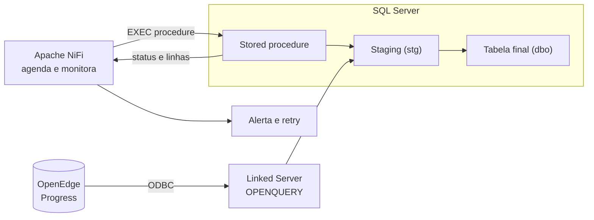
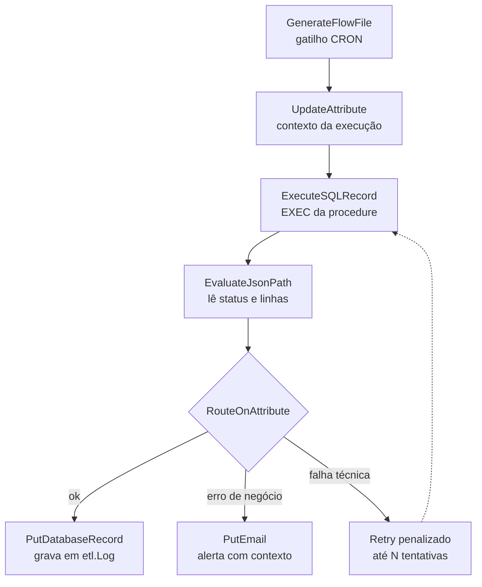

# Carga de dados OpenEdge (Progress) → SQL Server com Apache NiFi e Linked Server

Guia de arquitetura, padrões de carga (incremental e full), boas práticas e troubleshooting para integrar bancos **Progress OpenEdge** ao **SQL Server** usando o **Apache NiFi** como orquestrador e um **Linked Server (ODBC)** como ponte de leitura.

> **Ideia central:** o NiFi orquestra, agenda, monitora e trata falhas. O SQL Server faz o trabalho pesado de forma set-based. O Linked Server é o canal de leitura do OpenEdge.

> ⚠️ Os exemplos usam nomes fictícios (`LK_OPENEDGE`, `PUB.pedido`, `stg.Pedido`...). Adapte ao seu ambiente e **nunca** versione senhas, DSNs reais ou nomes de servidores de produção.

## Sumário

1. [O desafio](#1-o-desafio)
2. [Conceitos do NiFi usados no desenho](#2-conceitos-do-nifi-usados-no-desenho)
3. [Arquitetura](#3-arquitetura)
4. [Configurando o Linked Server](#4-configurando-o-linked-server-para-o-openedge)
5. [Anatomia do flow no NiFi](#5-anatomia-do-flow-no-nifi)
6. [Controle de carga (watermark)](#6-controle-de-carga-tabelas-de-watermark-e-log)
7. [Carga incremental](#7-carga-incremental)
8. [Carga full](#8-carga-full)
9. [Incremental ou full?](#9-incremental-ou-full-como-decidir)
10. [Armadilhas de tipagem e dados do OpenEdge](#10-armadilhas-de-tipagem-e-dados-do-openedge)
11. [Performance no SQL Server](#11-performance-no-sql-server)
12. [Resiliência e tratamento de erros](#12-resiliência-e-tratamento-de-erros-no-nifi)
13. [Segurança](#13-segurança)
14. [Observabilidade](#14-observabilidade)
15. [Versionamento e promoção](#15-versionamento-e-promoção-entre-ambientes)
16. [Troubleshooting](#16-troubleshooting)
17. [Checklist para novos fluxos](#17-checklist-para-novos-fluxos)

---

## 1. O desafio

Bancos Progress OpenEdge seguem firmes em muitas empresas (ERPs, produção, logística, varejo). O desafio é levar esses dados ao SQL Server para BI, relatórios e integrações. Pontos específicos:

- **Dialetos SQL diferentes:** o OpenEdge SQL-92 tem particularidades de tipos, datas e funções.
- **Driver ODBC:** é preciso um driver compatível (ex.: DataDirect OpenEdge Wire Protocol) e o **broker SQL** ativo no servidor OpenEdge.
- **Volume e janela de carga:** tabelas grandes exigem estratégia incremental ou full controlada.
- **Confiabilidade:** cargas precisam ser reprocessáveis, auditáveis e com alerta em caso de falha.
- **Governança:** sem controle central, vira uma colcha de retalhos de jobs e scripts.

---

## 2. Conceitos do NiFi usados no desenho

| Conceito | O que é | Por que importa na carga |
|---|---|---|
| **FlowFile** | Unidade de dado (conteúdo + atributos) que trafega no flow | Atributos carregam metadados da execução (fluxo, janela, linhas) |
| **Processor** | Bloco que executa uma ação (`ExecuteSQL`, `RouteOnAttribute`, `PutEmail`...) | Compõe cada etapa da carga |
| **Connection** | Fila entre processors, com back pressure e prioridade | Evita execuções sobrepostas e sobrecarga |
| **Controller Service** | Serviço compartilhado (ex.: `DBCPConnectionPool`) | Pool de conexão JDBC reutilizado e centralizado |
| **Process Group** | Agrupa um fluxo inteiro | Um grupo por fluxo de carga, fácil de versionar e clonar |
| **Parameter Context** | Parâmetros por ambiente, com suporte a valores sensíveis | Mesmo flow em DEV, HML e PRD, sem expor senha |
| **Data Provenance** | Histórico detalhado do caminho de cada FlowFile | Rastreabilidade e auditoria |

---

## 3. Arquitetura



Fluxo geral:

1. O **NiFi** dispara a execução por agendamento (CRON) ou evento.
2. Um `ExecuteSQL`/`ExecuteSQLRecord` chama uma **stored procedure** no SQL Server via JDBC.
3. A procedure lê o OpenEdge via **Linked Server** com `OPENQUERY`, grava em **staging** e consolida na tabela final.
4. A procedure devolve um resultado de uma linha (status, linhas lidas, linhas gravadas).
5. O NiFi interpreta o resultado e roteia: sucesso, falha, retry e notificação.

### Dois padrões possíveis

| | **Padrão A: NiFi orquestra, SQL Server carrega** | **Padrão B: NiFi transporta os dados** |
|---|---|---|
| Leitura do OpenEdge | Linked Server (`OPENQUERY`) | JDBC do OpenEdge direto no NiFi (`ExecuteSQLRecord`) |
| Gravação no SQL Server | `INSERT...SELECT` set-based dentro do SQL Server | `PutDatabaseRecord` |
| Dados passam pelo NiFi? | Não, só comandos e status | Sim, todo o volume |
| Pontos fortes | Alta performance, transformação em T-SQL, menos tráfego | Desacoplamento do SQL Server, transformação no flow |
| Pontos de atenção | Depende de o Linked Server estar estável | Exige tuning de memória, fetch size e tipos |

Este guia foca no **Padrão A**. Para volumes muito altos ou múltiplos destinos, o Padrão B pode fazer mais sentido.

---

## 4. Configurando o Linked Server para o OpenEdge

### 4.1 Pré-requisitos

- Driver **ODBC do OpenEdge** (64 bits) instalado no servidor SQL Server.
- **System DSN** 64 bits configurado (host, porta do broker SQL, banco, usuário).
- No OpenEdge: **broker SQL ativo** e usuário com `GRANT SELECT` nas tabelas necessárias.
- Manter o **SQL width** dos campos e as **estatísticas SQL** atualizadas no OpenEdge (via `dbtool` e `UPDATE STATISTICS`): isso afeta truncamento e plano de execução.

### 4.2 Criação

```sql
EXEC master.dbo.sp_addlinkedserver
    @server     = N'LK_OPENEDGE',
    @srvproduct = N'OpenEdge',
    @provider   = N'MSDASQL',
    @datasrc    = N'DSN_OPENEDGE';

EXEC master.dbo.sp_addlinkedsrvlogin
    @rmtsrvname  = N'LK_OPENEDGE',
    @useself     = N'False',
    @locallogin  = NULL,
    @rmtuser     = N'usr_leitura',
    @rmtpassword = N'********';   -- nunca versionar a senha real

-- Opções recomendadas (ajuste ao seu ambiente)
EXEC master.dbo.sp_serveroption N'LK_OPENEDGE', N'collation compatible', N'false';
EXEC master.dbo.sp_serveroption N'LK_OPENEDGE', N'data access',          N'true';
EXEC master.dbo.sp_serveroption N'LK_OPENEDGE', N'rpc out',              N'false';
EXEC master.dbo.sp_serveroption N'LK_OPENEDGE', N'connect timeout',      N'30';
EXEC master.dbo.sp_serveroption N'LK_OPENEDGE', N'query timeout',        N'0';

-- Propriedades do provider MSDASQL
EXEC master.dbo.sp_MSset_oledb_prop N'MSDASQL', N'AllowInProcess',   1;
EXEC master.dbo.sp_MSset_oledb_prop N'MSDASQL', N'DynamicParameters', 1;
```

### 4.3 Teste de conectividade

```sql
SELECT * FROM OPENQUERY(LK_OPENEDGE, 'SELECT TOP 5 * FROM PUB.pedido');
```

### 4.4 Por que `OPENQUERY` e não nomes de quatro partes

Com `LK_OPENEDGE...PUB.tabela`, o SQL Server pode trazer mais dados que o necessário e filtrar localmente. Com `OPENQUERY`, a consulta **executa inteira no lado do OpenEdge** e só o resultado trafega pela rede.

---

## 5. Anatomia do flow no NiFi



| Etapa | Processor | Função |
|---|---|---|
| 1. Gatilho | `GenerateFlowFile` (CRON) | Dispara no horário. Em cluster, **Primary Node only** |
| 2. Contexto | `UpdateAttribute` | Nome do fluxo, tipo de carga, correlation id |
| 3. Execução | `ExecuteSQLRecord` (ou `ExecuteSQL`) | `EXEC etl.usp_Carga_...` com retorno em JSON |
| 4. Leitura do resultado | `EvaluateJsonPath` | Extrai status, linhas lidas e gravadas para atributos |
| 5. Decisão | `RouteOnAttribute` | Separa sucesso, falha de negócio e falha técnica |
| 6. Sucesso | `LogAttribute` / `PutDatabaseRecord` | Registra a execução em tabela de auditoria |
| 7. Falha | `PutEmail` / `InvokeHTTP` | Alerta por e-mail, Teams, Slack ou ferramenta de monitoramento |
| 8. Retry | Relationship `failure` com **penalização** | Reexecuta com espera, sem martelar o banco |

### Detalhes que fazem diferença

- **Toda procedure com `SET NOCOUNT ON`** e finalizando com um `SELECT` de uma linha (status, linhas). Sem isso, contagens intermediárias podem atrapalhar a leitura do resultado pelo JDBC.
- **Evitar execuções sobrepostas:** `Max Concurrent Tasks = 1`, back pressure de 1 objeto na connection de entrada e `sp_getapplock` por fluxo dentro da procedure.
- **Timeouts coerentes:** o `Max Wait Time` do ExecuteSQL deve ser maior que o tempo esperado da carga, assim como o query timeout do Linked Server.
- **Parameter Context:** URL JDBC, usuário, senha (sensível), e-mail de alerta e schema ficam em parâmetros, não no processor.

---

## 6. Controle de carga: tabelas de watermark e log

```sql
CREATE SCHEMA etl;
GO
CREATE SCHEMA stg;
GO

CREATE TABLE etl.Controle (
    Fluxo          varchar(100) NOT NULL PRIMARY KEY,
    TipoCarga      char(1)      NOT NULL,   -- I = incremental, F = full
    UltimaMarca    datetime2(3) NULL,       -- watermark por data de alteração
    UltimaChave    bigint       NULL,       -- watermark alternativo por chave
    UltimaExecucao datetime2(3) NULL,
    Status         varchar(20)  NULL
);

CREATE TABLE etl.Log (
    IdLog          bigint IDENTITY PRIMARY KEY,
    Fluxo          varchar(100)   NOT NULL,
    Inicio         datetime2(3)   NOT NULL,
    Fim            datetime2(3)   NULL,
    LinhasLidas    int            NULL,
    LinhasGravadas int            NULL,
    Status         varchar(20)    NOT NULL,
    Mensagem       nvarchar(4000) NULL
);

-- Cada fluxo precisa de uma linha inicial
INSERT etl.Controle (Fluxo, TipoCarga) VALUES ('PEDIDO', 'I');
```

O watermark só avança **quando a carga termina com sucesso**. Se falhar, o próximo ciclo reprocessa a mesma janela.

---

## 7. Carga incremental

### 7.1 Quando usar

Tabelas grandes, com coluna confiável de alteração (`dt_alteracao`) ou chave sequencial crescente.

### 7.2 Estratégias de marca d'água

| Estratégia | Como funciona | Risco |
|---|---|---|
| Por data de alteração | `WHERE dt_alteracao >= @marca` | Depende de a aplicação sempre atualizar a coluna |
| Por chave crescente | `WHERE id > @ultima_chave` | Não captura alterações em registros antigos |
| Janela deslizante | Relê os últimos N dias a cada execução | Mais volume, mas absorve atrasos e correções retroativas |
| Comparação por hash | Compara hash de linha entre origem e destino | Custoso; indicado para tabelas pequenas ou médias |

Na prática: **data de alteração com janela de segurança** (relê 1 a 2 dias) e consolidação **idempotente**. Reprocessar linhas já carregadas não causa dano.

### 7.3 Procedure de exemplo

```sql
CREATE OR ALTER PROCEDURE etl.usp_Carga_Incremental_Pedido
AS
BEGIN
    SET NOCOUNT ON;
    SET XACT_ABORT ON;

    DECLARE @fluxo   varchar(100) = 'PEDIDO',
            @inicio  datetime2(3) = SYSDATETIME(),
            @de      datetime2(3),
            @sql     nvarchar(max),
            @lidas   int = 0,
            @gravadas int = 0,
            @idlog   bigint,
            @lock    int;

    -- Barreira contra execução sobreposta (lock de sessão)
    EXEC @lock = sp_getapplock @Resource = @fluxo, @LockMode = 'Exclusive',
                               @LockOwner = 'Session', @LockTimeout = 0;
    IF @lock < 0
    BEGIN
        SELECT 'ignorado' AS status, 0 AS linhas_lidas, 0 AS linhas_gravadas;
        RETURN;
    END;

    INSERT etl.Log (Fluxo, Inicio, Status) VALUES (@fluxo, @inicio, 'executando');
    SET @idlog = SCOPE_IDENTITY();

    BEGIN TRY
        -- Janela de segurança de 2 dias
        SELECT @de = DATEADD(DAY, -2, UltimaMarca)
        FROM etl.Controle WHERE Fluxo = @fluxo;
        SET @de = COALESCE(@de, '2000-01-01');

        TRUNCATE TABLE stg.Pedido;

        -- OPENQUERY não aceita variáveis: o texto é montado dinamicamente.
        -- Atenção às aspas: {d ''2026-01-01''} chega ao OpenEdge como {d '2026-01-01'}
        SET @sql = N'INSERT INTO stg.Pedido (cod_pedido, cod_cliente, dt_pedido, vl_total, dt_alteracao)
            SELECT cod_pedido, cod_cliente, dt_pedido, vl_total, dt_alteracao
            FROM OPENQUERY(LK_OPENEDGE, ''SELECT cod_pedido, cod_cliente, dt_pedido, vl_total, dt_alteracao
                                         FROM PUB.pedido
                                         WHERE dt_alteracao >= {d ''''' + CONVERT(char(10), @de, 120) + '''''}'')';
        EXEC sys.sp_executesql @sql;
        SET @lidas = @@ROWCOUNT;

        -- Transação curta, só na consolidação (a leitura remota fica fora dela)
        BEGIN TRAN;

        MERGE dbo.Pedido AS t
        USING stg.Pedido AS s ON t.cod_pedido = s.cod_pedido
        WHEN MATCHED AND (t.vl_total <> s.vl_total
                          OR t.cod_cliente <> s.cod_cliente
                          OR t.dt_alteracao <> s.dt_alteracao) THEN
            UPDATE SET t.cod_cliente  = s.cod_cliente,
                       t.dt_pedido    = s.dt_pedido,
                       t.vl_total     = s.vl_total,
                       t.dt_alteracao = s.dt_alteracao
        WHEN NOT MATCHED BY TARGET THEN
            INSERT (cod_pedido, cod_cliente, dt_pedido, vl_total, dt_alteracao)
            VALUES (s.cod_pedido, s.cod_cliente, s.dt_pedido, s.vl_total, s.dt_alteracao);
        SET @gravadas = @@ROWCOUNT;

        UPDATE etl.Controle
           SET UltimaMarca    = (SELECT MAX(dt_alteracao) FROM stg.Pedido),
               UltimaExecucao = SYSDATETIME(),
               Status         = 'ok'
         WHERE Fluxo = @fluxo
           AND EXISTS (SELECT 1 FROM stg.Pedido);

        COMMIT;

        UPDATE etl.Log
           SET Fim = SYSDATETIME(), LinhasLidas = @lidas,
               LinhasGravadas = @gravadas, Status = 'ok'
         WHERE IdLog = @idlog;

        EXEC sp_releaseapplock @Resource = @fluxo, @LockOwner = 'Session';
        SELECT 'ok' AS status, @lidas AS linhas_lidas, @gravadas AS linhas_gravadas;
    END TRY
    BEGIN CATCH
        IF @@TRANCOUNT > 0 ROLLBACK;

        UPDATE etl.Log
           SET Fim = SYSDATETIME(), Status = 'erro', Mensagem = ERROR_MESSAGE()
         WHERE IdLog = @idlog;

        DECLARE @msg nvarchar(4000) = ERROR_MESSAGE();
        EXEC sp_releaseapplock @Resource = @fluxo, @LockOwner = 'Session';
        SELECT 'erro' AS status, @lidas AS linhas_lidas, 0 AS linhas_gravadas, @msg AS mensagem;
    END CATCH;
END;
```

> **Importante:** o `sp_getapplock` com `@LockOwner = 'Session'` fica preso à **conexão**. Como o pool JDBC do NiFi reutiliza conexões, o lock precisa ser liberado explicitamente (`sp_releaseapplock`) em todos os caminhos de saída, como feito acima. Caso contrário, a próxima execução na mesma conexão do pool pode ser ignorada indevidamente ou outra conexão ficar bloqueada.

**Pontos de atenção:**

- A procedure **captura o erro e devolve status**, em vez de deixar a exceção estourar. Assim o NiFi roteia com contexto (mensagem, linhas).
- O `MERGE` tem condição de mudança no `WHEN MATCHED`, evitando updates inúteis. Cuidado com `NULL` nas comparações (use `EXISTS (SELECT s.col EXCEPT SELECT t.col)` ou `ISNULL`).
- Muitos DBAs preferem `UPDATE` + `INSERT` ao `MERGE` por bugs históricos e comportamento sob concorrência. Avalie conforme sua versão e carga.
- **Exclusões na origem não aparecem** em carga incremental. Para refletir deletes: soft delete no OpenEdge, tabela de log de exclusão ou conferência periódica de chaves (origem × destino).

---

## 8. Carga full

### 8.1 Quando usar

Tabelas pequenas, sem coluna confiável de alteração, tabelas de domínio/parametrização, ou como **recarga de recuperação** após inconsistência.

### 8.2 Padrão com troca atômica (swap)

Em vez de `TRUNCATE` na tabela final (deixando usuários sem dados durante a carga), carrega-se em uma tabela paralela e troca-se o nome em uma transação curta. As três tabelas devem ter **estrutura, índices e permissões equivalentes**.

```sql
-- 1. Carrega na tabela paralela (pode demorar; ninguém é impactado)
TRUNCATE TABLE dbo.Cliente_New;

INSERT INTO dbo.Cliente_New WITH (TABLOCK) (cod_cliente, nome, cidade, ativo)
SELECT cod_cliente, RTRIM(nome), RTRIM(cidade), ativo
FROM OPENQUERY(LK_OPENEDGE, 'SELECT cod_cliente, nome, cidade, ativo FROM PUB.cliente');

-- 2. Validação antes de trocar (ajuste o piso à realidade da tabela)
IF (SELECT COUNT(*) FROM dbo.Cliente_New) = 0
    THROW 50001, 'Carga full retornou zero linhas. Troca cancelada.', 1;

-- 3. Troca rápida: a tabela antiga vira a próxima "paralela"
BEGIN TRAN;
    EXEC sp_rename 'dbo.Cliente',     'Cliente_Old';
    EXEC sp_rename 'dbo.Cliente_New', 'Cliente';
    EXEC sp_rename 'dbo.Cliente_Old', 'Cliente_New';
COMMIT;

-- 4. Limpa a antiga (agora Cliente_New) para a próxima execução
TRUNCATE TABLE dbo.Cliente_New;
```

Alternativas: `ALTER TABLE ... SWITCH` entre tabelas de estrutura idêntica (troca em metadado) ou uma view apontando para a tabela ativa. Atenção: `sp_rename` não renomeia constraints e índices, então os nomes de objetos ficam trocados. Padronize com isso em mente ou prefira `SWITCH`.

### 8.3 Proteções importantes

- **Validação de volume:** se a origem devolver zero linhas, ou menos que X% do esperado, cancele a troca e alerte. Uma falha de leitura nunca pode virar tabela vazia em produção.
- **Cargas grandes:** quebrar por faixa de chave e executar em lotes, reduzindo timeout e pressão no OpenEdge.
- **Recovery model:** em janelas controladas, `SIMPLE` ou `BULK_LOGGED` com `TABLOCK` permite *minimal logging*.

---

## 9. Incremental ou full? Como decidir

| Critério | Incremental | Full |
|---|---|---|
| Tamanho da tabela | Grande | Pequena ou média |
| Coluna confiável de alteração | Sim | Não |
| Captura de exclusões | Precisa de tratamento extra | Natural |
| Carga na origem (OpenEdge) | Baixa | Alta |
| Complexidade | Maior (watermark, consolidação) | Menor |
| Uso típico | Fatos e transações | Cadastros, domínios, recuperação |

A decisão é **por fluxo**, não global. Mantenha também uma full de recuperação para tabelas incrementais, que pode ser disparada sob demanda por parâmetro no NiFi.

---

## 10. Armadilhas de tipagem e dados do OpenEdge

| Situação | Cuidado |
|---|---|
| Campos `CHARACTER` | Podem vir com espaços à direita. Use `RTRIM` na origem ou no staging |
| `String or binary data would be truncated` | Verifique o **SQL width** do campo no OpenEdge e o tamanho da coluna destino |
| Datas e timestamps | Prefira escapes ODBC `{d '...'}` e `{ts '...'}` nos filtros. Valide fuso e datas inválidas/vazias |
| `DECIMAL` | Confirme precisão e escala. `CAST` explícito no staging |
| Valores *unknown* (`?`) do Progress | Chegam como `NULL`. Ajuste regras `NOT NULL` no destino |
| Campos extent (arrays) | Aparecem como colunas numeradas na visão SQL. Mapeie com cuidado |
| Collation | `collation compatible = false` e tratamento explícito de comparações de texto |
| Performance de leitura | Filtre por campos **indexados** no OpenEdge; sem índice vira varredura completa |

**Regra que poupa retrabalho:** o staging usa tipos amplos e tolerantes; a conversão rigorosa acontece na passagem para a tabela final, com registro das linhas rejeitadas.

---

## 11. Performance no SQL Server

- **Staging sem índices e sem constraints** durante a carga.
- **`TABLOCK` + minimal logging** em cargas full, conforme o recovery model.
- **Lotes** para tabelas muito grandes, evitando transações gigantes e crescimento descontrolado do log.
- **Índice na chave do MERGE** na tabela destino. Sem isso o MERGE vira varredura.
- **`UPDATE STATISTICS`** nas tabelas finais após cargas grandes.
- **RCSI** (Read Committed Snapshot) no banco de destino, para que consultas de BI não bloqueiem nem sejam bloqueadas pela carga.
- **Janelas e Resource Governor** em servidores compartilhados.
- **Colunas de auditoria** (`dt_carga`, `id_log`) nas tabelas finais.

---

## 12. Resiliência e tratamento de erros no NiFi

- **Retry com penalização:** em falha transitória (rede, timeout), a connection devolve o FlowFile após um intervalo, evitando loop agressivo.
- **Limite de tentativas:** contador em atributo (`retry.count`) e `RouteOnAttribute` para sair do loop e alertar após N falhas.
- **Separar falha técnica de falha de negócio:** erro de conexão é diferente de volumetria zerada ou validação rejeitada. Cada uma tem rota e alerta próprios.
- **Back pressure** nas connections para impedir acúmulo de execuções.
- **Idempotência:** qualquer fluxo pode rodar duas vezes sem corromper dados. Isso simplifica toda a recuperação.
- **Alerta com contexto:** nome do fluxo, janela, mensagem de erro e referência para a Data Provenance.

---

## 13. Segurança

- **Menor privilégio no OpenEdge:** o usuário do Linked Server só tem `SELECT` nas tabelas necessárias.
- **Menor privilégio no SQL Server:** o login do NiFi só executa as procedures do schema `etl`.
- **Segredos fora do flow e fora do Git:** senhas em **Parameter Context sensível** ou provedor de segredos.
- **Criptografia em trânsito:** TLS na interface do NiFi e, quando suportado, nas conexões JDBC e ODBC.
- **Rastreabilidade:** `etl.Log` e Data Provenance formam a trilha de auditoria.
- **Políticas de acesso do NiFi:** documentar quem pode alterar flows em produção.

---

## 14. Observabilidade

- **Data Provenance:** quando um dado entrou, por onde passou, o que aconteceu.
- **Bulletin Board e logs do NiFi:** erros de processors e controller services.
- **Reporting Tasks:** métricas (ex.: Prometheus) para dashboards de filas, tempo e falhas.
- **SQL Server:** dashboards sobre `etl.Log` (duração, linhas, status) e alertas de volumetria anormal e watermark parado.
- **SLA por fluxo:** um fluxo sem execução bem-sucedida na janela esperada gera alerta, mesmo sem erro explícito.

Exemplo de consulta para detectar fluxos atrasados:

```sql
SELECT Fluxo, UltimaExecucao, Status,
       DATEDIFF(MINUTE, UltimaExecucao, SYSDATETIME()) AS minutos_sem_execucao
FROM etl.Controle
WHERE UltimaExecucao < DATEADD(HOUR, -2, SYSDATETIME())   -- ajuste ao SLA do fluxo
   OR Status <> 'ok';
```

---

## 15. Versionamento e promoção entre ambientes

- **NiFi Registry + Git:** versionar Process Groups e promover DEV → HML → PRD.
- **Parameter Contexts por ambiente:** o flow é o mesmo; só os parâmetros mudam.
- **Scripts do banco no Git:** procedures, tabelas de controle e Linked Server criados por script idempotente.
- **Padronização:** nomenclatura (`usp_Carga_Incremental_<Tabela>`, `stg.<Tabela>`), template de Process Group e de procedure. Novo fluxo = clonar template e ajustar parâmetros.

Estrutura sugerida deste repositório:

```
.
├── README.md
├── sql/
│   ├── 01_linked_server.sql
│   ├── 02_schemas_controle_log.sql
│   ├── 03_usp_carga_incremental_modelo.sql
│   └── 04_carga_full_swap_modelo.sql
├── nifi/
│   └── flows/            # exports versionados (sem credenciais)
└── docs/
    └── diagramas/
```

---

## 16. Troubleshooting

| Sintoma | Causa provável | Ação |
|---|---|---|
| `Data source name not found and no default driver specified` | DSN criado no ODBC de 32 bits, ou DSN de usuário | Criar **System DSN 64 bits** no servidor do SQL Server |
| `Cannot initialize the data source object of OLE DB provider MSDASQL` | `AllowInProcess` desabilitado, driver ausente ou credencial inválida | Habilitar `AllowInProcess`, validar driver e login mapeado |
| Timeout / `Login timeout expired` | Broker SQL do OpenEdge parado, firewall ou porta incorreta | Testar conectividade e porta; verificar o broker |
| `String or binary data would be truncated` | SQL width menor que o dado real ou coluna destino curta | Ajustar SQL width (`dbtool`) e tamanho no staging |
| Erro de transação distribuída (MSDTC) com `INSERT...SELECT` em transação | Promoção para transação distribuída | Manter a leitura remota fora da transação de consolidação; revisar MSDTC |
| Query lenta no OpenEdge | Filtro em campo sem índice ou estatísticas SQL desatualizadas | Filtrar por índice; atualizar estatísticas SQL |
| `OPENQUERY` com erro de sintaxe | Aspas mal duplicadas em SQL dinâmico | `PRINT @sql`, validar níveis de aspas, testar a query isolada no OpenEdge |
| NiFi não reconhece o retorno da procedure | Falta `SET NOCOUNT ON` ou resultado sem `SELECT` final | Padronizar o retorno de uma linha |
| Execuções sobrepostas | Agendamento menor que o tempo da carga | `Max Concurrent Tasks = 1`, back pressure e `sp_getapplock` |
| Execução "ignorada" sem motivo aparente | Lock de sessão não liberado em conexão do pool | Garantir `sp_releaseapplock` em todos os caminhos |

---

## 17. Checklist para novos fluxos

- [ ] Tipo de carga definido (incremental ou full) e justificado
- [ ] Coluna de watermark validada com o time da aplicação
- [ ] Filtro usa campo indexado no OpenEdge
- [ ] Staging com tipos tolerantes e conversão controlada
- [ ] Consolidação idempotente (`MERGE` ou `UPDATE` + `INSERT`)
- [ ] Tratamento de exclusões definido
- [ ] Validação de volume antes de trocar ou consolidar
- [ ] `sp_getapplock`/`sp_releaseapplock` e `Max Concurrent Tasks = 1`
- [ ] Retorno padronizado (status, linhas lidas, linhas gravadas)
- [ ] Log em `etl.Log` e alerta de falha e de atraso
- [ ] Parâmetros e segredos no Parameter Context
- [ ] Flow versionado no Registry e scripts no Git
- [ ] Teste de reprocessamento e de falha da origem

---

## Resultados

> Preencha com números reais do seu ambiente (remova esta seção se não quiser expor):
>
> - Redução do tempo de carga da tabela X de **[__ horas]** para **[__ minutos]**
> - **[__]** fluxos em produção, **[__]** cargas por dia
> - Eliminação de **[__]** processos manuais e jobs dispersos

## Autor

**Yan Furlan**: DBA SQL Server · [LinkedIn](https://www.linkedin.com/in/yan-furlan-455ab820b/)

## Licença

[MIT](LICENSE) ou a de sua preferência.

---

**Sugestão de topics para o repositório:** `apache-nifi` · `sql-server` · `progress-openedge` · `etl` · `data-engineering` · `linked-server` · `dba` · `tsql`
